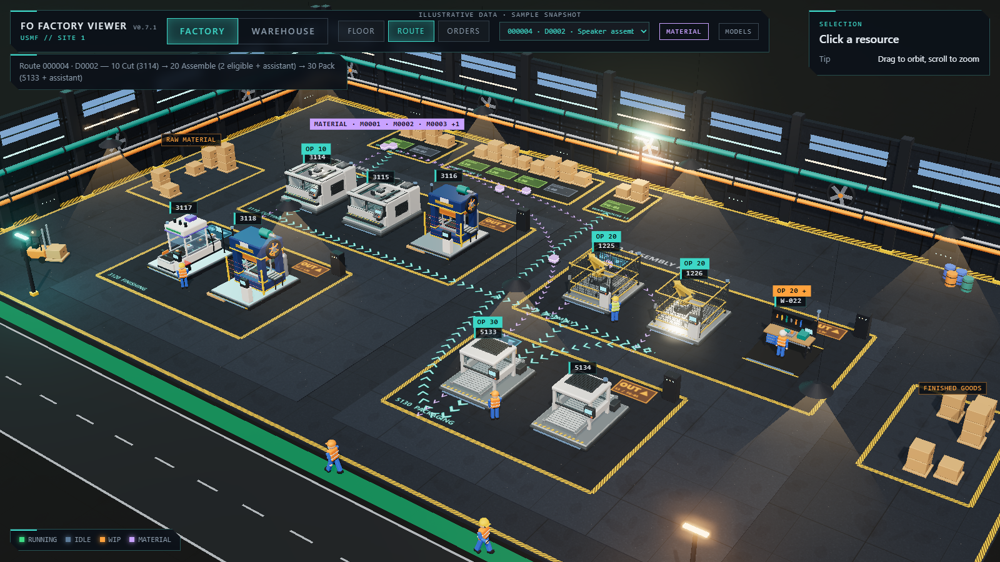
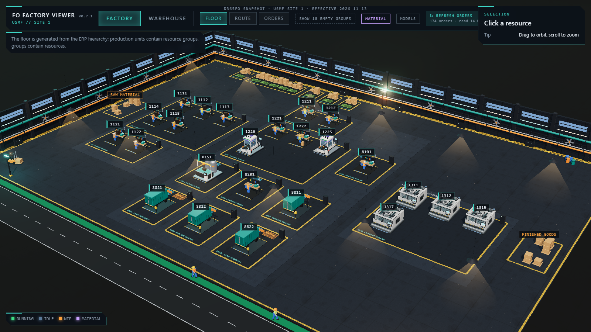
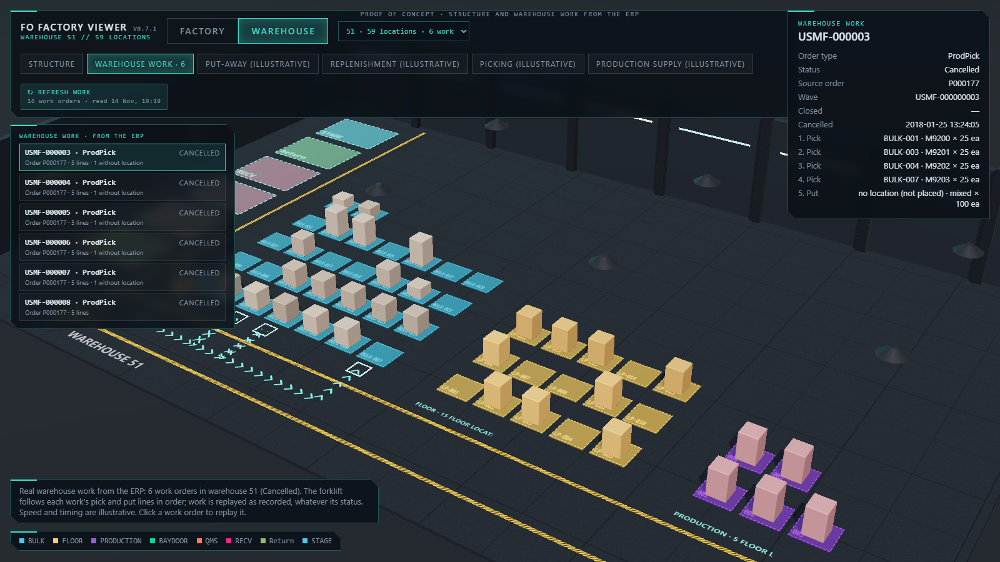

# FO Factory Viewer

**See your Dynamics 365 Finance & Operations manufacturing model as a living 3D factory.**

FO Factory Viewer is a community project that reads the production setup of Dynamics 365 Finance & Operations (production units, resource groups, resources, routes, BOMs, production orders and warehouse work) and turns it into an animated, game-style factory floor and warehouse. It is read-only: it never writes to the ERP.



## What you can see

| Factory floor from the ERP hierarchy | Warehouse work replayed at real locations |
| --- | --- |
|  |  |

- **Floor** — the shop floor is generated from the hierarchy: site → production unit → resource group → resource. No coordinates are needed; the layout is automatic.
- **Route** — pick a route and watch carts travel between operations. An operation that names a capability or a group lights every eligible resource.
- **Orders** — production orders replayed on a timeline against the jobs the ERP scheduled.
- **Material** — violet lanes and crates carry components from the location the BOM line consumes from to the resource that uses them.
- **Warehouse** — any warehouse laid out from its locations (aisle, rack, shelf, bin, zone), with its real warehouse work replayed by a forklift, line by line.
- **Models** — the ERP does not say whether a resource is a press or a robot. A panel maps resources to 3D models with rules by resource, group, type or capability; the mapping stays local.
- **Layout** — the automatic floor is a starting point. Drag resources, groups or whole production units to match your real plant; the positions are saved locally in `layout.json` and routes and orders follow them. On the warehouse page, rack aisles and floor areas can be moved the same way (`warehouse-layout.json`). The floor itself can be resized and reshaped (L, T, U, annexes) on both pages.

## Try it in one minute

Requires [Node.js](https://nodejs.org) 22 or later and an internet connection (Three.js is loaded from a CDN). No packages to install.

```sh
git clone <this repository> fo-factory-viewer
cd fo-factory-viewer
npm start
```

Open http://127.0.0.1:4174. You will see the sample factory, built from invented data in the same shape as a real extract. On Windows you can double-click `start.bat` instead.

## Connect your own Dynamics 365

Everything real lives in `data/local/`, which git ignores. Nothing below writes to the ERP.

1. **Structure.** In Data management, export a package with the *410 - Production control* template (XML). Then:
   ```sh
   node tools/import-dmf.mjs <extracted-package-folder> data/local/my-site --site 1 --company USMF
   ```
2. **Connection for live reads.** Register an application in Microsoft Entra ID, link it to a Dynamics 365 user under *System administration > Setup > Microsoft Entra applications*, and give that user roles with read access to the data entities you need (production orders, route jobs, BOM lines, warehouse work). Copy [`docs/connection.example.json`](docs/connection.example.json) to `data/local/connection.local.json` and fill it in. The client secret is not stored in that file: on Windows it is kept encrypted for your user with `Export-Clixml`, and `secretFile` points to it.
3. **Orders.** Read production orders, operations, scheduled jobs and BOM lines (GET only):
   ```sh
   node tools/extract-orders.mjs data/local/my-site
   ```
4. **Warehouses (optional).** Export the warehouse setup with Data management and import it; then read the warehouse work:
   ```sh
   node tools/import-warehouse.mjs <extracted-warehouse-package> data/local/my-site
   node tools/extract-warehouse-work.mjs data/local/my-site
   ```
5. Open http://127.0.0.1:4174/viewer/?data=local/my-site. Once the connection exists, **Refresh orders** and **Refresh work** buttons re-read the ERP from the page; the credentials stay in the local server.

An access error (HTTP 403) on a data entity usually means the user's roles grant the screens but not the entity itself: the entity privilege must grant *Read* in the *Data services* integration mode, be part of a role of that user, and be published.

## What is real and what is not

- **From the ERP:** the hierarchy, resources and capabilities, which resources can perform each operation, routes, BOMs, production orders and their scheduled jobs, BOM line consumption locations, warehouse locations and zones, and warehouse work with its lines.
- **Derived:** the floor layout (unless you move things by hand), the position inside a rack (read from the location ID), and which 3D model stands for each resource.
- **Viewer conventions:** speeds, how long a zero-length job is shown as busy, and the moment a material crate arrives (when the job starts).
- **Decoration:** lamps, dust, the logistics lane with its trains and pedestrians, the boxes on warehouse shelves, and the flows marked *illustrative* on the warehouse page.

## Project layout

| Path | Purpose |
| --- | --- |
| `viewer/index.html` | Factory page (single file, no build step) |
| `viewer/warehouse.html` | Warehouse page |
| `viewer/floor.js` | Floor shapes and their editor, shared by both pages |
| `viewer/models/` | glTF models of the CNC, robot and packaging cells |
| `data/sample/` | Invented sample data in the snapshot format |
| `data/local/` | Your real extracts and connection file; ignored by git |
| `tools/serve.mjs` | Local server: static files, the refresh buttons, saving the model mapping and the layout |
| `tools/import-dmf.mjs` | Snapshot from a Data management package |
| `tools/extract-orders.mjs` | Orders, jobs and BOM lines over OData (GET only) |
| `tools/import-warehouse.mjs` | `warehouses.json` from a warehouse Data management package |
| `tools/import-warehouse-work.mjs`, `tools/extract-warehouse-work.mjs` | Warehouse work, from a package or over OData |
| `tools/fo-client.mjs` | The read-only OData client: GET only, one environment, credentials never printed |

## Versions

The current version is shown in the viewer header and in `package.json`. [`CHANGELOG.md`](CHANGELOG.md) lists what each version added and [`ROADMAP.md`](ROADMAP.md) what comes next.

## Licence

Copyright © 2026 Sergi Segués.

FO Factory Viewer is free software under the [GNU Affero General Public License v3.0](LICENSE) (AGPL-3.0-only). You may use, study, modify and share it, including commercially, provided that anything you distribute or offer to users over a network is released with its complete source code under the same licence, and that the copyright and licence notices are kept.

**Commercial licence.** If you want to build it into a closed product or service without the AGPL obligations, a separate commercial licence is available from the author; get in touch through the author's GitHub profile.

**Contributions.** Because the project is dual-licensed, contributions can only be accepted if their author agrees that they may be distributed under both the AGPL and the commercial licence. Please say so in your pull request.

Dynamics 365, Finance and Operations and Microsoft Entra are trademarks of Microsoft. This project is not affiliated with or endorsed by Microsoft.
